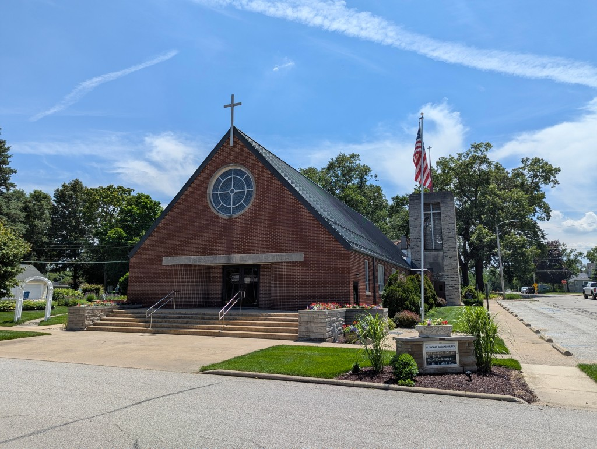

## Quick Links
- [**Weekly Bulletin**](https://parishesonline.com/organization/st-thomas-aquinas-church-46534)
- [*Mass Schedule*](#mass-schedule)
- [Contact Info](about.html)
- [Event Calendar](calendar.html)

## News
### Liturgical Minister Training
For all current, new, and interested lectors (readers), music ministers, extraordinary ministers of Holy Communion, and ushers.

**Either** Monday, November 16 at 7:00pm **or** Friday, November 20 at 9:00am

### Altar & Rosary Society: Christmas Party and “Cookie Walk”
The Altar & Rosary Society will be meeting December 7 at noon for their annual Christmas luncheon and brief meeting in Zollinger Hall. All ladies of the church are invited to attend, especially if you are interested in joining the Society. Members are asked to bring a gift for Bella Vita.

Also, our annual Cookie Walk and mini bazaar will be December 12 from 10:00am to 2:00pm. All ladies are asked to bake at least 4 dozen cookies and bring them to Zollinger Hall before 9:00am on that day. Please call Cathy Raab if you have any questions.

### Special Meet & Greet: “Cookies around the World”
Sunday, December 13 after the 9:00am Mass – Come downstairs for fellowship and enjoy Christmas cookies, treats, and snacks from all over the world. If you are able to bring treats from your ethnic heritage, let Jacalynn Ciboch or Ana Perez know!

### _Fides_: Adult Faith Formation
Wednesdays after the 5pm Mass
Zollinger Hall (church basement)

On November 18 learn about the two Sacraments of Service, Holy Orders and Matrimony, and on December 2 begin a four-part Advent journey through the kerygma—the story of our salvation—which will supplement Fr. Jordan’s Advent Sunday homilies.

## Mass Schedule
### Sunday Masses
Saturday (anticipatory) | 4:30pm  
Sunday | 9:00am
### Weekday Masses
Mon, Tue, Thu, Fri | 8:00am  
Wed | 5:00pm (followed by *Fides,* adult faith formation)
## Sacraments & Sacramentals
### Confession
Saturday | 3:00–4:00pm or by appointment
### Eucharistic Adoration
1st Friday, after Mass  
1st Sunday, 8:00am
### Baptism, Matrimony, Anointing of the Sick
Please contact the parish office; for weddings, please contact us before scheduling a date
## Contact Info
St. Thomas Aquinas Catholic Church  
406 E Washington St.  
Knox, IN 46534  
(574) 772-4134  
[parish@stthomasknox.org](mailto:parish@stthomasknox.org)  
**Fr. Jordan Fetcko, Administrator**

**St. Vincent de Paul Help Line**  
(574) 806-0431
## Parish Staff
Administrator  
Rev. Jordan C. Fetcko  
[jfetcko@stthomasknox.org](mailto:jfetcko@stthomasknox.org)

Secretary  
Cathy Raab  
[craab@stthomasknox.org](mailto:craab@stthomasknox.org)

Director of Religious Education  
Catherine Phipps  
[cphipps@stthomasknox.org](mailto:cphipps@stthomasknox.org)

***
*St. Thomas Aquinas Church is a registered 501(c)(3) non-profit organization. Goodstack charity ID: 0103048200*

*Mission statement: St. Thomas Aquinas Church is the Catholic community of Knox, seeking to proclaim the Gospel of Jesus Christ to Starke County and beyond by providing sacraments, opportunities for prayer and devotion, and faith formation to all who wish to grow in relationship with their Savior.*
